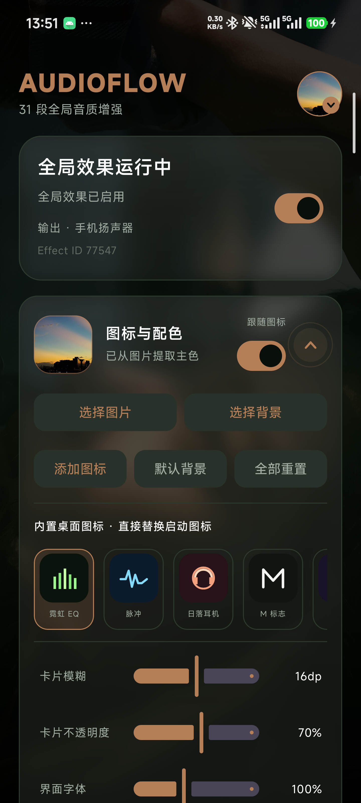

# AudioFlow



AudioFlow is a rootless Android global audio equalizer prototype inspired by the
audio-effect architecture used by Flowmix. It does not record, capture, or proxy
audio from other applications.

## How it works

- Creates an Android `DynamicsProcessing` effect on audio session `0`, the
  global output mix.
- Applies a 31-band EQ and limiter through Android's audio server.
- Uses `MODIFY_AUDIO_SETTINGS`, a normal permission, plus a foreground service
  to keep the effect alive.
- Re-registers after device route changes or loss of effect control.

No root access, `RECORD_AUDIO`, MediaProjection, or AudioPlaybackCapture is used.

## Features

- Enable/disable the global effect.
- Six sound presets, including a dedicated movie curve, and a custom 31-band
  EQ.
- FxSound `.fac` import, including the effect parameters used by the installed
  FxSound presets and arbitrary band counts from the file.
- Generic AutoEQ PEQ and GraphicEQ text import. Parametric filters are sampled
  into the 31 fixed Android `DynamicsProcessing` bands.
- Saved headphone/configuration profiles, including the profile name stored in
  each `.fac` file.
- Dynamic bass combines a frequency-limited low-end boost with low-band
  multiband compression, so ordinary volumes receive an audible bass increase
  without simply scaling the entire signal.
- Adjustable `0.1`, `0.5`, `1`, and `2 dB` EQ steps with per-band `+`/`-`
  controls.
- Custom App artwork from a photo, automatic dominant-color extraction, and
  dynamic accent colors across the interface.
- Eight built-in adaptive launcher icons that directly switch the installed
  Android app icon through `activity-alias` components.
- Custom home-screen shortcut artwork. Android does not permit a normal app to
  replace its installed launcher icon arbitrarily, so custom artwork is offered
  through a pinnable shortcut.
- Independent custom background image with a readability overlay.
- Adjustable background dimming, background blur, and a true local backdrop
  blur with a translucent glass-card layer and adjustable card opacity.
- App-local UI font scaling from 80% to 130%, independent of the Android
  system font scale.
- Hold-to-compare A/B bypass for listening to the original unprocessed mix.
- Named configuration snapshots with restore and delete actions.
- Quick navigation from the header avatar plus collapsible feature cards for
  shorter scrolling sessions.
- Rounded chevron controls for collapse and quick-navigation affordances.
- Immersive transparent system bars so the background and glass cards continue
  behind the status bar while content remains inset for readability.
- Explicit anti-clipping protection switch. It controls automatic preamp
  headroom and the DynamicsProcessing limiter.
- App-scoped activation using active playback attribution and selected launcher
  apps.
- Detailed or minimal foreground notification.
- Optional notification-free personal/test mode backed by a user-enabled
  accessibility service. This does not read window content.
- Automatic headroom protection for positive EQ gains.
- Foreground notification and Quick Settings tile.
- Built-in 100 Hz to 10 kHz listening sweep.

## Build

```powershell
$env:JAVA_HOME='<path-to-jdk-17>'
$env:ANDROID_HOME='<path-to-android-sdk>'
.\gradlew.bat :app:assembleDebug
```

On macOS or Linux:

```bash
export JAVA_HOME="/path/to/jdk-17"
export ANDROID_HOME="/path/to/android-sdk"
./gradlew :app:assembleDebug
```

The debug APK is written to:

```text
app/build/outputs/apk/debug/app-debug.apk
```

Install it on a connected device:

```bash
adb install -r -t app/build/outputs/apk/debug/app-debug.apk
```

## Compatibility

- Requires Android 9 (API 28) or newer.
- The global-session `DynamicsProcessing` path is supported by this Xiaomi
  Android 17 device but remains OEM-dependent.
- App-scoped mode uses Android's global mixer. It is isolated when the selected
  app is the only active audio source; concurrent audio from other apps also
  passes through the same global effect.
- A normal Android app cannot hide its foreground-service notification. The
  notification-free path requires giving AudioFlow an accessibility service and
  is intended for personal side-loaded testing rather than general store
  distribution.
- Audio paths that bypass Android's normal output mixer may not be affected.
- The included APK is debug-signed and intended for local testing.

The `Powered By Meldryk` brand line uses Sora under the SIL Open Font License;
the license is included at `app/src/main/assets/licenses/Sora-OFL.txt`.

## Privacy and permissions

- AudioFlow does not request `RECORD_AUDIO`, MediaProjection, or
  AudioPlaybackCapture.
- Global processing uses Android's `DynamicsProcessing` audio effect and the
  normal `MODIFY_AUDIO_SETTINGS` permission.
- The optional notification-free mode requires a user-enabled accessibility
  service. It is used only to keep the foreground effect alive and does not
  read window content.

## License

AudioFlow is released under the [MIT License](LICENSE).
